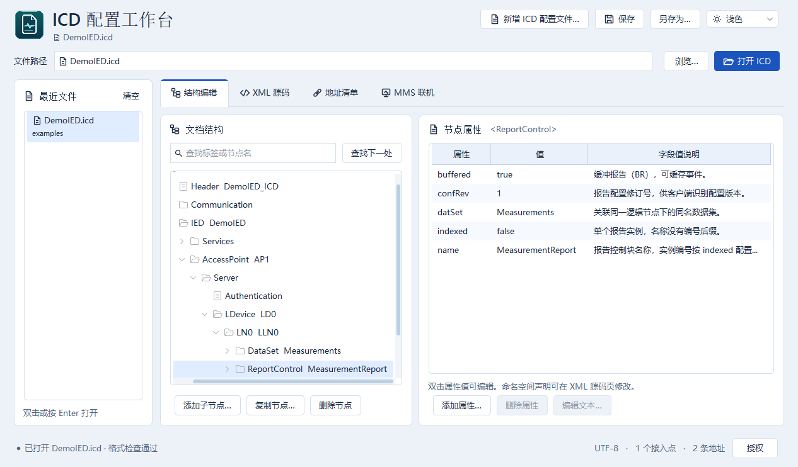
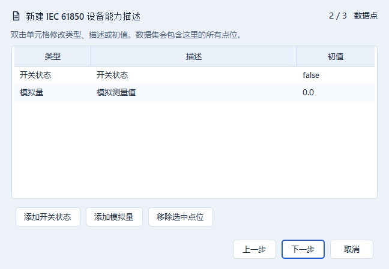
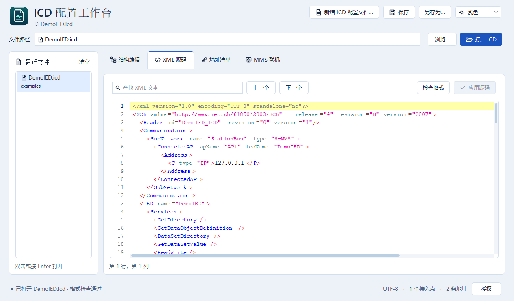
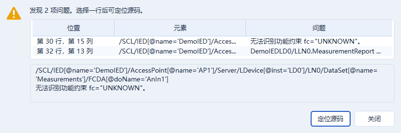
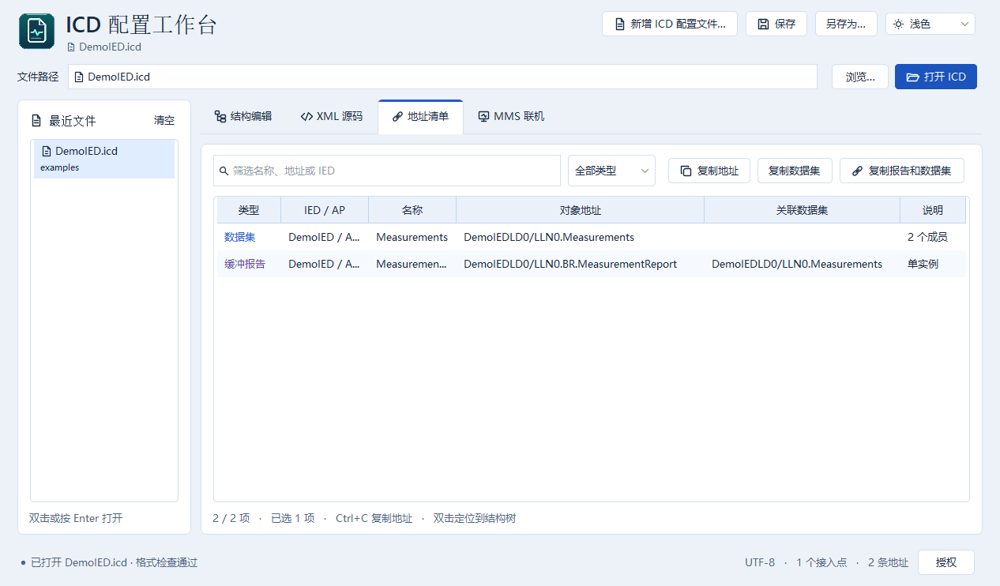
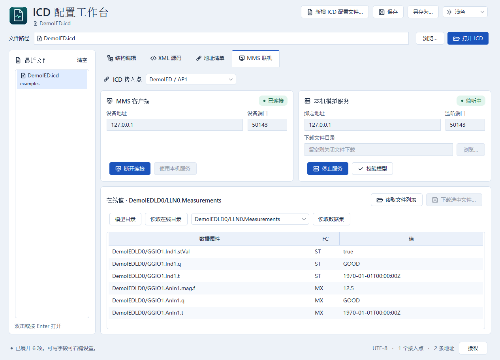

# ICD 配置工作台

IEC 61850 ICD/SCL 文件查看、编辑与格式校验工具，支持报告控制块和数据集地址提取、MMS 联机与本机模拟。

## 下载安装

在 GitHub 仓库的 [**Releases → v1.5.3 → Assets**](https://github.com/qvwen/icd-workbench/releases/tag/v1.5.3) 下载 **ICD-Workbench-1.5.3-Setup-x64.exe**。

1. 双击安装包，选择安装位置，并按需要勾选 **创建桌面快捷方式**。
2. 安装完成后，从开始菜单或桌面快捷方式打开 **ICD 配置工作台**。

适用于 Windows x64。安装包已内置运行环境，无需单独安装 Java 或 JDK。

## 功能一览

| 功能 | 操作说明 |
| --- | --- |
| 打开与校验 | 粘贴路径或点击 **浏览…**，打开 ICD、CID、SCD、IID 和 SCL XML。自动检查 XML 语法及常见 SCL 结构和引用，发现问题时显示行列、元素路径和原因。 |
| 结构编辑 | 在树中查找元素，双击编辑属性值。支持添加、复制或删除子节点，属性表提供中文的字段值说明。 |
| XML 编辑 | 支持行号、语法高亮、搜索和折叠。修改后可点击 **检查格式**，问题列表可跳到对应位置。 |
| 新建 ICD | 通过向导填写 IED、接入点、逻辑设备、开关状态和模拟量，生成数据集及可选的报告控制块。 |
| 地址清单 | 筛选和复制报告控制块地址及数据集地址，双击结果可跳到定义位置。 |
| MMS 联机 | 连接 IED，读取模型目录及数据集。点击报告控制块或数据集地址查看字段，右击可写字段可设置值并回读。 |
| 本机模拟 | 根据 ICD 启动本机 MMS 服务，设置模拟值及下载文件目录，也可离线修改 ICD 初值。 |
| MMS 文件服务 | 连接支持文件服务的设备后，可读取文件清单并下载选中文件。 |
| 桌面体验 | 支持最近文件、常用快捷键，以及浅色、深色、IntelliJ 和 Darcula 四种主题。 |

## 界面预览

截图使用示例 ICD 文件，联机界面连接的是本机模拟服务。

### 结构编辑

左侧显示最近文件，中间用树浏览 SCL 元素，右侧显示选中元素的属性和字段值说明。

新增 ICD 配置向导

按步骤填写设备和接入点，添加开关状态、模拟量及其初值，再配置数据集和报告。

XML 编辑与格式校验

问题列表可指出无效的功能约束、缺失的模板或报告引用不到的数据集。能打开的文件可从问题列表跳到对应行继续修正。

地址清单

报告控制块与关联数据集可在同一页查看和复制。下图中的示例包含以下地址。

| 类型 | 地址 |
| --- | --- |
| 缓冲报告控制块 | `DemoIEDLD0/LLN0.BR.MeasurementReport` |
| 数据集 | `DemoIEDLD0/LLN0.Measurements` |

MMS 联机与本机模拟

上方用于连接设备、启动本机模拟和配置下载目录，下方用于浏览模型、展开字段和查看读取值。

## 常用操作

- **打开文件** 在顶部路径框粘贴完整路径并按 `Enter`，或点击 **浏览…** 选择。双击左侧最近文件可重新打开。
- **创建 ICD** 点击 **新增 ICD 配置文件…**，按向导填写设备与接入点、数据点、数据集和报告，最后选择保存位置。
- **本机联调** 打开 ICD 后切换到 **MMS 联机**，选择接入点并点击 **启动服务**。再点击 **使用本机服务 → 连接设备**，即可读取在线目录或数据集。
- **修改字段** 在 **模型目录** 中点击报告或数据集地址。离线时右击字段选 **设置 ICD 初值…**，然后保存文件。联机时右击可写字段选 **设置字段值… → 写入并回读**，能否写入由设备权限决定。
- **文件下载** 模拟服务启动前可指定 **下载文件目录**。客户端连接后，点击 **读取文件列表**，选中文件再点击 **下载选中文件…**。

## 试用和激活

首次启动可免费试用 **7 天**。窗口右下角显示授权状态，试用到期后需输入激活码继续使用。

1. 点击窗口右下角的授权状态，选择 **输入激活码…**。
2. 复制设备码，通过维护者提供的私下渠道发送。
3. 取得激活码后，将其贴到授权窗口并点击 **激活**。激活绑定当前设备。

需要申请激活时，可通过下方方式询问维护者如何联系。

## 问题反馈

请在 GitHub 仓库点击 [**Issues → New issue**](https://github.com/qvwen/icd-workbench/issues/new/choose) 联系维护者。提交问题时，请附上软件版本、Windows 版本、复现步骤和错误提示。格式校验问题可附上提示的行列及元素路径，联机问题请注明使用的是真实设备或本机模拟。

如果需要附截图或配置文件，请先遮盖实际设备 IP 和项目名称。设备码与激活码请通过私下渠道发送。
