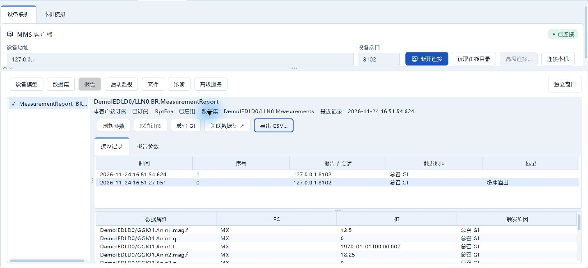
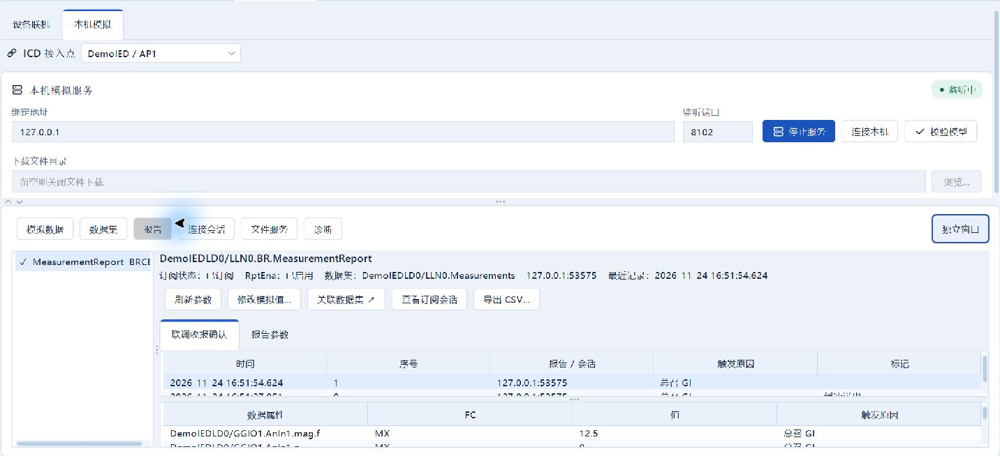
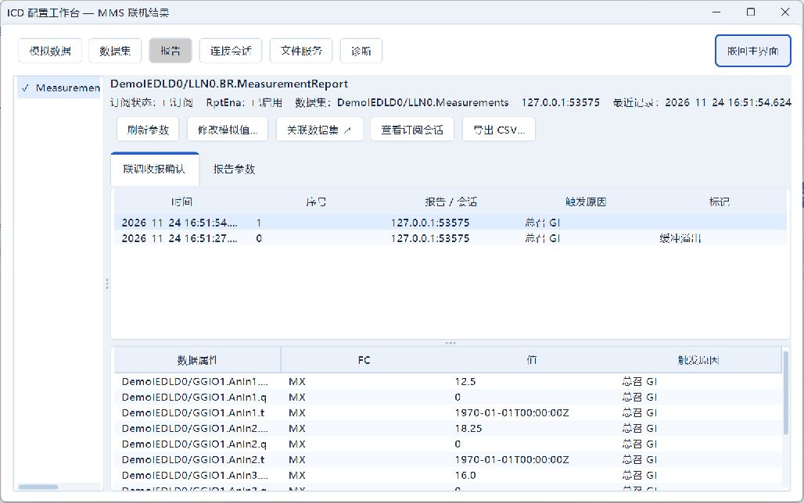

ICD 配置工作台 v1.5.7 是 Windows x64 更新，主要改进 MMS 设备联机、本机模拟和报告联调。

[下载 Windows x64 安装包](https://github.com/qvwen/icd-workbench/releases/download/v1.5.7/ICD-Workbench-1.5.7-Setup-x64.exe)

双击安装包即可安装，可选安装位置和桌面快捷方式。安装包已内置运行环境。

## 与 v1.5.3 相比

| 功能 | v1.5.7 的变化 |
| --- | --- |
| MMS 联机工作区 | 拆分为「设备联机」和「本机模拟」。连接参数、操作按钮和结果页按当前工作区显示。结果区支持调整高度，也可弹出带标题栏和窗口按钮的独立窗口。 |
| 设备连接与模型浏览 | 支持高级连接参数、连接错误提示、在线逻辑设备和数据对象浏览。可读取属性、写入设备允许的字段，并回读实际值。 |
| 数据集与监视 | 可查看并读取数据集成员，在设备允许时创建和删除动态数据集。活动监视可查看属性变化和报告事件，支持导出 CSV。 |
| 报告控制块 | 支持 BRCB 和 URCB 的参数读取、订阅、取消订阅及 GI 总召。列表直接显示订阅状态，接收记录可查看时间、序号、触发原因和成员值。 |
| 本机模拟 | 按选定 ICD 接入点生成原生服务，保留报告实例原名、缓冲类型和关联数据集，无需另建 `_UR` 报告。可修改模拟值、查看连接会话和订阅状态。模拟端的收报确认记录来自本工具客户端。 |
| 原生通信与文件下载 | 设备联机和模拟服务统一通过 `IEC61850Library` 调用 `libiec61850`。Windows 文件服务支持中文目录和文件名，下载完成并核对字节数后才写入目标文件。 |

## 软件运行截图

以下截图来自打包版软件，使用示例 ICD 和本机回环连接。

### 设备联机与 BRCB 总召

### 本机模拟与订阅状态

### 独立报告结果窗口

## 验证

- 25 项测试全部通过，覆盖 ICD 工作流、MMS 报告、中文文件下载和窗口操作。
- 使用上一版后端原有的 libiec61850 1.5.1 客户端验证 ICD 原名 BRCB 的启用、GI 总召收报和停用。

[查看 v1.5.3 发布记录](https://github.com/qvwen/icd-workbench/releases/tag/v1.5.3)
